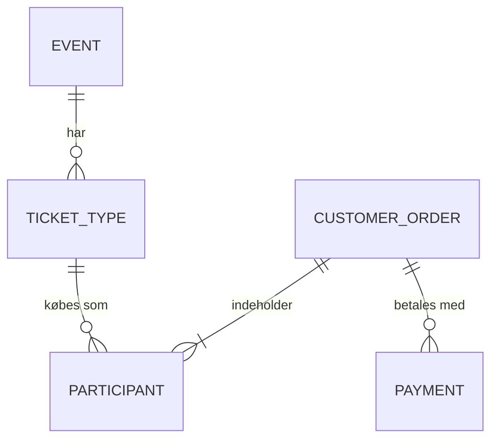

# Billetsystem

Billetbestilling og adminsystem til events med siddepladser, fx messer og workshops, bygget med Java (Spring Boot) og PostgreSQL.

> **Status: klar til test i drift.** Bestillingsside, adminside (overblik, bestillinger, deltagere, borde, billettyper, events, betaling), flere events, pladsreservation, betalingsinfo, bekræftelsesmails og sikkerhed (login-spærring, grænse for bestillinger, sikre cookies) er på plads og dækket af unit tests. Betaling med kort/MobilePay via Stripe er endnu ikke lavet. Se [roadmap](#roadmap).
>
> Dette er et hobbyprojekt.

## Baggrund

I dag bestiller man billet til messen ved at sende en mail, får et kontonummer tilbage og betaler med bankoverførsel. Det giver meget manuelt arbejde for arrangørerne. Projektet skal erstatte det med:

- en bestillingsside, hvor man vælger billetter og betaler med kort eller MobilePay
- en adminside, hvor arrangørerne kan se deltagerlisten, antal solgte billetter og styre priser (fx early bird)

## Teknologi

| Lag | Valg |
|---|---|
| Backend | Java 21, Spring Boot 3.5 (Spring Web, Spring Data JPA, Bean Validation, Spring Security) |
| Database | PostgreSQL |
| Udviklingsmiljø | Docker Compose |
| Frontend | HTML, CSS og JavaScript uden framework (serveres af Spring Boot fra `src/main/resources/static`) |
| Betaling | Bankoverførsel/MobilePay med betalingsinfo; Stripe Checkout er planlagt |
| Mail | Spring Mail (SMTP); Mailpit under udvikling |

## Hvad der virker nu

- Bestillingsside på http://localhost:8081, hvor man tilføjer deltagere, vælger billettype, ser totalen og bestiller. Fejl fra serveren vises ved det felt, de hører til
- **Flere events**, fx en messe hvert halve år. Har flere events billetter til salg samtidig, vælger kunden først event. Hvert event kan have et max antal deltagere. Når det er nået, vises eventet som udsolgt, og serveren afviser flere bestillinger
- Billettyper med pris og gyldighedsperiode, så fx early bird skifter automatisk til normalpris på en bestemt dato
- `GET /api/ticket-types/current` viser de billetter, der kan købes lige nu
- `POST /api/orders` opretter en bestilling med flere deltagere. Prisen beregnes på serveren, og inputtet valideres
- Samlet fejlformat, så frontenden altid får læselige fejlbeskeder
- Adminlogin på http://localhost:8081/admin med brugere fra `admin_user` (BCrypt-hashede kodeord). Alt under `/admin` og `/api/admin` kræver login
- **Beskyttelse mod gætteri:** efter 5 forkerte kodeord på samme brugernavn, eller 20 fra samme IP-adresse, inden for 15 minutter spærres login i 15 minutter. Ukendte brugernavne behandles ens, så man ikke kan se, om et brugernavn findes. Et vellykket login nulstiller tælleren
- **Grænse for bestillinger:** højst 10 bestillinger i timen fra samme IP-adresse (derefter 429), så ingen kan fylde eventet med falske bestillinger
- **Statusskift med kapacitetstjek:** genåbnes en annulleret bestilling, tjekkes det først, at der stadig er plads på eventet
- **Overblik:** omsætning (betalt og afventende), solgte billetter, aktivitet de seneste 7 dage, graf over billetter pr. dag, salg pr. billettype og de nyeste bestillinger. En påmindelse viser, hvor mange bestillinger der venter på betaling
- **Bestillinger:** søg og filtrér på status, se detaljer og skift status (markér som betalt, annullér, refundér, genåbn). Kun lovlige statusskift er mulige. Eksport til CSV
- **Deltagerliste:** alle deltagere med søgning og filter på billettype, eksport til CSV (åbner direkte i dansk Excel) og en printvenlig tjekind-liste med afkrydsningsfelt til indgangen
- **Billettyper:** se priser, perioder og salg, opret nye billettyper og ret eksisterende (fx early bird-perioder). Nye priser gælder kun nye bestillinger
- **Betaling med bankoverførsel/MobilePay:** arrangørerne indtaster kontonummer, evt. MobilePay, betalingsfrist og en besked under "Betaling" på adminsiden. Efter bestilling ser kunden beløb, konto, en reference ("Bestilling 42") og fristen, med en kopiér-knap ved hver værdi. Når pengene er modtaget, markerer arrangørerne bestillingen som betalt. Bestillinger med overskredet frist markeres på adminsiden og annulleres automatisk af et job, der kører hver time, så pladserne frigives
- **Bekræftelsesmails:** efter bestilling får kunden en mail med deltagere, pladsønsker, total, betalingsinfo og eventets praktiske info. Når arrangørerne markerer bestillingen som betalt, får kunden en mail om, at betalingen er modtaget. På adminsiden kan man se, om mailene er sendt, og sende dem igen. Mails sendes i baggrunden, så en nede mailserver aldrig stopper en bestilling
- **Pladsreservation:** ved hver deltager kan man vælge begynder-/singlebordet eller bede om en bordende af helbredsmæssige årsager (kun ja/nej, årsagen gemmes ikke). Deltagere på samme bestilling sidder sammen, og en gruppe kan skrive fulde navne på andre med egen billet, de vil sidde med
- **Borde (admin):** grupper med de navne, de vil sidde med, slået op blandt deltagerne (navne uden billet markeres), samt lister over begynder-/singlebordet og bordender. Kan printes. Ønskerne står også på deltagerlisten, i bestillingen og i CSV-filen
- **Praktisk info pr. event**, fx gæstebilletter og åbningstider, vises under "Godt at vide" på bestillingssiden
- **Events:** opret, ret og slet events (navn, datoer, max antal deltagere). Et event med aktive bestillinger (afventer betaling eller betalt) kan ikke slettes. Annullerede og refunderede bestillinger slettes med eventet. En vælger i menuen bestemmer, hvilket event overblik, bestillinger, deltagere og billettyper viser. Uden valg vises det næste kommende event

## Datamodel



| Tabel | Indhold |
|---|---|
| `event` | Et event, fx en messe (navn, datoer, evt. max antal deltagere). Der kan være mange |
| `ticket_type` | Billettyper med pris i øre og gyldighedsperiode |
| `customer_order` | En bestilling med kontaktperson, evt. navne gruppen vil sidde med, status (`PENDING`, `PAID`, `CANCELLED`, `REFUNDED`) og samlet beløb |
| `participant` | Én række pr. billet med deltagerens fulde navn, den pris, der blev betalt, og pladsønsker (begynderbord, bordende) |
| `payment` | Betalinger fra Stripe (oprettet i databasen, endnu ikke brugt af koden) |
| `admin_user` | Logins til adminsiden. Kodeord gemmes som BCrypt-hash |
| `payment_settings` | Betalingsoplysninger (konto, MobilePay, frist, besked). Altid præcis én række |

Der er også et view, `v_ticket_sales`, som giver antal solgte billetter og indtægt pr. billettype. Det tæller kun betalte bestillinger.

## Designvalg

- **Prisen findes kun på serveren.** Frontenden sender aldrig en pris, så ingen kan ændre den. Serveren slår prisen op ud fra, hvilken billettype der gælder på bestillingstidspunktet.
- **Én bestilling = ét event.** Serveren afviser en bestilling med billetter til flere events.
- **Ingen overbooking.** Gælder både nye og genåbnede bestillinger (`EventService.reserveSeats`). Afventende og betalte bestillinger optager en plads. Ved bestilling låses eventets række i databasen (`SELECT ... FOR UPDATE`), så to samtidige bestillinger ikke kan tage de samme sidste pladser.
- **Beløb gemmes i øre** som heltal (29500 = 295,00 kr.), så der ikke opstår afrundingsfejl.
- **Prisen kopieres til hver deltager**, så historikken stemmer, selv hvis billetprisen ændres senere.
- **En bestilling bliver først betalt, når Stripe bekræfter det** (planlagt), ikke fordi brugeren lander på en tak-side.
- **Databasen styres af `database/schema.sql`.** Hibernate kontrollerer kun ved opstart, at Java-klasserne passer til tabellerne (`ddl-auto=validate`).
- **Så få følsomme data som muligt.** Bordende af helbredsmæssige årsager gemmes kun som ja/nej, ikke årsagen.
- **Hemmeligheder ligger ikke i koden.** Databasekodeordet læses fra miljøvariablen `DB_PASSWORD`, og den første admins kodeord fra `ADMIN_PASSWORD`.
- **Lukket, medmindre andet er sagt.** `SecurityConfig` lister præcis, hvad besøgende må (bestillingssiden, `GET /api/ticket-types/current`, `POST /api/orders`). Alt andet kræver adminlogin.

## Kom i gang med Docker (nemmest)

Kræver kun [Docker Desktop](https://www.docker.com/products/docker-desktop/). Du behøver hverken Java, Maven eller PostgreSQL installeret.

```bash
cp .env.example .env      # ret DB_PASSWORD i .env til dit eget kodeord
docker compose up --build
```

Det starter:

| Service | Hvad | Adresse |
|---|---|---|
| `db` | PostgreSQL 16, hvor `database/schema.sql` køres automatisk | `localhost:5433` |
| `app` | Spring Boot-programmet | http://localhost:8081 |
| `mailpit` | Fanger alle mails fra programmet, så du kan se dem (der sendes aldrig rigtige mails) | http://localhost:8025 |

Databasen ligger på port **5433** på din computer, så den ikke støder sammen med en anden PostgreSQL på 5432. Inde i Docker taler `app` med `db` på den almindelige port.

**Kør koden fra IntelliJ i stedet:** start kun databasen med `docker compose up -d db`, og sæt disse miljøvariabler i din run configuration:

```
DB_PASSWORD=dit-kodeord;SPRING_DATASOURCE_URL=jdbc:postgresql://localhost:5433/billetsystem;ADMIN_PASSWORD=dit-admin-kodeord;SESSION_COOKIE_SECURE=false
```

**Se databasen i pgAdmin:** opret en server med host `localhost` (eller `host.docker.internal`, hvis pgAdmin selv kører i Docker), port `5433`, bruger `billetsystem` og kodeordet fra `.env`.

**Nulstil databasen:** `schema.sql` køres kun, når databasen er tom. Sådan starter du forfra:

```bash
docker compose down -v
docker compose up --build
```

**Admin-login:** den første admin oprettes automatisk ud fra `ADMIN_USERNAME` og `ADMIN_PASSWORD` i `.env`, hvis der ikke findes nogen admin endnu. Log ind på http://localhost:8081/admin.

**Opdatering af en eksisterende database:** `schema.sql` køres kun på en tom database. Nye tabeller til en database, der allerede er i brug, ligger i `database/migrations/` og kan køres flere gange uden skade:

```bash
docker compose exec -T db psql -U billetsystem -d billetsystem < database/migrations/2026-11-03-payment-settings.sql
docker compose exec -T db psql -U billetsystem -d billetsystem < database/migrations/2026-11-03-pladsreservation.sql
docker compose exec -T db psql -U billetsystem -d billetsystem < database/migrations/2026-11-03-bekraeftelsesmail.sql
```

**Mail i drift:** uden for Docker sendes mails kun, hvis `MAIL_HOST` er sat. Ellers virker alt andet som normalt. Sæt disse miljøvariabler til jeres mailudbyders SMTP-server:

| Variabel | Eksempel |
|---|---|
| `MAIL_HOST` | `smtp.example.com` |
| `MAIL_PORT` | `587` |
| `MAIL_USERNAME`, `MAIL_PASSWORD` | login hos mailudbyderen |
| `MAIL_FROM` | `Eventforeningen <billetter@example.com>` |
| `MAIL_REPLY_TO` | valgfri: adressen, kunderne svarer til |

Brug en afsenderadresse på jeres eget domæne, og opsæt SPF og DKIM hos mailudbyderen, så mailene ikke havner i spam.

**Session-cookie i drift:** lad `SESSION_COOKIE_SECURE` være `true` (standard), og kør programmet bag HTTPS.

**Bag en proxy:** kører programmet bag en proxy eller load balancer, så sæt `FORWARD_HEADERS_STRATEGY=native`. Ellers ser alle ud til at have proxyens IP-adresse, og login-spærringen pr. IP rammer alle på én gang.

**Låst ude?** Spærringen ligger i hukommelsen, så en genstart af programmet ophæver den med det samme (`docker compose restart app`).

**Har du ændret Java-koden?** Kør `docker compose up --build` igen for at bygge et nyt image.

## Kom i gang uden Docker

### Krav

- Java 21 eller nyere
- PostgreSQL (testet med version 16)
- IntelliJ IDEA, eller Maven hvis du kører fra terminalen

### 1. Opret databasen

```sql
CREATE DATABASE billetsystem;
```

Kør derefter `database/schema.sql` i databasen, fx i pgAdmin (Query Tool) eller med
`psql -d billetsystem -f database/schema.sql`.

> **Advarsel:** filen starter med `DROP TABLE`, så den nulstiller alle tabeller. Brug den kun på en tom eller ny database. Den indeholder også eksempeldata (en messe og to billettyper), som du bør tilpasse.

### 2. Opret en databasebruger til projektet

Skift `SkrivEtKodeordHer` ud med et kodeord, du selv vælger:

```sql
CREATE USER billetsystem WITH PASSWORD 'SkrivEtKodeordHer';
GRANT CONNECT ON DATABASE billetsystem TO billetsystem;
GRANT USAGE ON SCHEMA public TO billetsystem;
GRANT SELECT, INSERT, UPDATE, DELETE ON ALL TABLES IN SCHEMA public TO billetsystem;
GRANT USAGE, SELECT ON ALL SEQUENCES IN SCHEMA public TO billetsystem;
ALTER DEFAULT PRIVILEGES IN SCHEMA public GRANT SELECT, INSERT, UPDATE, DELETE ON TABLES TO billetsystem;
ALTER DEFAULT PRIVILEGES IN SCHEMA public GRANT USAGE, SELECT ON SEQUENCES TO billetsystem;
```

Vil du bruge en anden bruger, så ret `spring.datasource.username` i `src/main/resources/application.properties`.

### 3. Start programmet

Sæt miljøvariablen `DB_PASSWORD` til kodeordet fra trin 2 og start programmet.

- **IntelliJ:** åbn `BilletsystemApplication`, vælg **Run → Edit Configurations → Modify options → Environment variables**, skriv `DB_PASSWORD=dit-kodeord;SESSION_COOKIE_SECURE=false`, og kør.
- **Terminal:** `DB_PASSWORD=dit-kodeord SESSION_COOKIE_SECURE=false mvn spring-boot:run`

`SESSION_COOKIE_SECURE=false` er nødvendig lokalt, fordi http://localhost ikke er HTTPS. Ellers sender browseren ikke session-cookien, og login virker ikke. I drift skal den være `true` (standard).

Programmet kører på **http://localhost:8081**. Porten kan ændres med `server.port` i `application.properties`.

Før første start kan du også sætte `ADMIN_PASSWORD` (mindst 10 tegn) og evt. `ADMIN_USERNAME` (standard: `admin`). Så opretter programmet den første admin automatisk, og du kan logge ind på http://localhost:8081/admin.

### 4. Prøv det af

Filen `http/requests.http` indeholder færdige forespørgsler, som du kan køre direkte fra IntelliJ. Du kan også bruge `curl`:

```bash
# Hent billettyper, der kan købes nu
curl http://localhost:8081/api/ticket-types/current

# Opret en bestilling
curl -X POST http://localhost:8081/api/orders \
  -H "Content-Type: application/json" \
  -d '{
        "contactName": "Lene Mortensen",
        "email": "lene.mortensen@example.com",
        "participants": [
          { "fullName": "Lene Mortensen", "ticketTypeId": 2 }
        ]
      }'
```

## API

### `GET /api/ticket-types/current`

Returnerer de billettyper, der kan købes lige nu (slået til, startet og ikke udløbet), billigste først.

```json
[
  {
    "id": 2,
    "eventName": "Forårsmessen 2027",
    "name": "Standard",
    "priceOre": 29500,
    "validFrom": "2026-10-07T22:00:00Z",
    "validTo": null
  }
]
```

### `POST /api/orders`

Opretter en bestilling med status `PENDING`. Svarer med `201 Created`. Har arrangørerne udfyldt betalingsoplysninger, indeholder svaret `payment` med beløb, konto, reference og frist.

| Felt | Krav |
|---|---|
| `contactName` | påkrævet, maks. 150 tegn |
| `email` | påkrævet, skal ligne en e-mail |
| `phone` | valgfri, maks. 30 tegn |
| `note` | valgfri |
| `participants` | 1 til 20 deltagere, hver med `fullName` (påkrævet) og `ticketTypeId` (påkrævet) |

Er input ugyldigt, svarer serveren med `400` og en forklaring, fx `{"fejl": "Ugyldige data", "felter": {...}}`. Bestiller man en billettype, der ikke kan købes lige nu (fx en udløbet early bird), får man også `400`.

### Admin-API (kræver login)

| Endpoint | Hvad |
|---|---|
| `GET /api/admin/payment-settings`, `PUT /api/admin/payment-settings` | Hent eller gem betalingsoplysninger |
| `GET /api/admin/seating?eventId=` | Grupper, begynder-/singlebord og bordender |
| `GET /api/admin/events` | Alle events med salgstal |
| `POST /api/admin/events`, `PUT /api/admin/events/{id}`, `DELETE /api/admin/events/{id}` | Opret, ret eller slet et event |
| `GET /api/admin/overview` | Alle tal til overblikket |
| `GET /api/admin/orders?status=&search=` | Bestillinger, nyeste først |
| `GET /api/admin/orders/{id}` | Én bestilling med deltagere |
| `POST /api/admin/orders/{id}/status` | Skift status, fx `{"status": "PAID"}` |
| `POST /api/admin/orders/{id}/mail?type=confirmation` | Send bekræftelsen igen (`type=payment-received`: mailen om modtaget betaling) |
| `GET /api/admin/orders.csv` | Alle bestillinger som CSV |
| `GET /api/admin/participants?search=&ticketTypeId=&includeCancelled=` | Deltagerliste |
| `GET /api/admin/participants.csv` | Deltagerliste som CSV |
| `GET /api/admin/ticket-types` | Billettyper med salgstal |
| `POST /api/admin/ticket-types?eventId=`, `PUT /api/admin/ticket-types/{id}` | Opret en billettype til et event, eller ret en |

POST og PUT kræver CSRF-nøglen fra `GET /api/csrf` i headeren `X-CSRF-TOKEN`.

**Om tallene:** "Betalt" er bestillinger med status `PAID`, og "afventer" er `PENDING`. Annullerede og refunderede bestillinger tæller ikke som solgt. Tallene gælder ét event ad gangen (`?eventId=`). Uden `eventId` bruges det næste event, der ikke er slut.

## Tests

```bash
docker run --rm -v "$PWD":/app -w /app maven:3.9-eclipse-temurin-21 mvn -q test
```

Eller kør dem fra IntelliJ (højreklik på `src/test/java` → Run 'All Tests'). Testene kræver ingen database.

Testene dækker statusskift, prisberegning (early bird, normalpris, udløbne billettyper), kapacitet ved bestilling og genåbning, automatisk annullering efter betalingsfristen, login-spærring, grænsen for bestillinger og den generelle fejlhåndtering.

## Projektstruktur

```
billetsystem/
├─ database/
│  ├─ schema.sql                 databaseskema, view og eksempeldata
│  └─ migrations/                ændringer til en database, der allerede er i brug
├─ http/
│  └─ requests.http              færdige testforespørgsler til IntelliJ
├─ Dockerfile                    bygger og kører programmet
├─ docker-compose.yml            PostgreSQL, programmet og Mailpit
├─ .env.example                  skabelon til .env (DB_PASSWORD)
├─ pom.xml
├─ src/test/java/               unit tests (fx reglerne for login-spærring)
└─ src/main/
   ├─ java/dk/billetsystem/
   │  ├─ BilletsystemApplication.java
   │  ├─ model/                  JPA-klasser (Event, TicketType, CustomerOrder, Participant)
   │  ├─ repository/             opslag i databasen (Spring Data JPA)
   │  ├─ service/                forretningsregler (TicketService, OrderService, AdminOrderService, StatisticsService)
   │  ├─ controller/             REST-API og fejlhåndtering
   │  ├─ mail/                   bekræftelsesmails (indhold, afsendelse i baggrunden)
   │  ├─ security/               adgangsregler, login og oprettelse af første admin
   │  └─ dto/                    objekter til ind- og udgående JSON
   └─ resources/
      ├─ application.properties
      └─ static/                 bestillingssiden (index.html, css/, js/)
         └─ admin/               login, overblik, bestillinger, deltagere og billettyper
```

## Roadmap

- [x] Databaseskema i PostgreSQL
- [x] Hent billettyper, der kan købes nu
- [x] Opret bestilling med serverberegnet pris og validering
- [x] Bestillingsside i HTML og JavaScript
- [x] Adminlogin (Spring Security)
- [x] Overblik med salgstal og graf
- [x] Bestillinger med statusskift (markér som betalt ved bankoverførsel)
- [x] Deltagerliste, tjekind-liste og eksport til CSV
- [x] Administration af billettyper og early bird-perioder
- [x] Flere events med max antal deltagere
- [x] Betalingsinfo til bankoverførsel og MobilePay med frist
- [ ] Betaling med Stripe (kort og MobilePay)
- [x] Bekræftelsesmail og mail om modtaget betaling
- [x] Pladsreservation (grupper, begynder-/singlebord, bordende) og info om gæstebilletter
- [x] Sikkerhed: login-spærring, grænse for bestillinger pr. IP, sikre session-cookies, Docker uden root
- [x] Automatisk annullering af ubetalte bestillinger efter betalingsfristen
- [x] Unit tests af de vigtigste forretningsregler
- [ ] Hosting med HTTPS, rigtig mailudbyder og betalingsoplysninger
